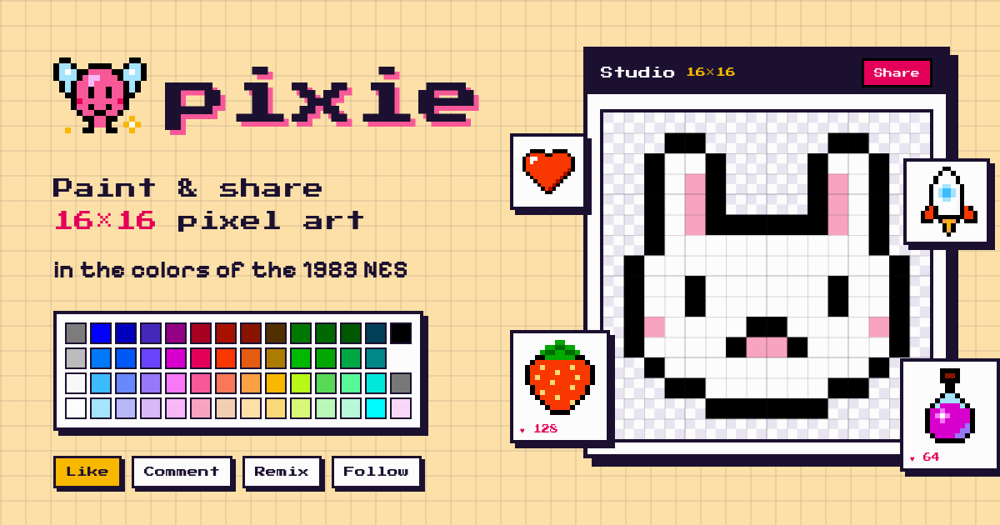

# pixie



**pixie** is a social app for tiny pixel art. Paint a **16×16** picture with the colors of the **1983 NES**, share it, and people can like it, comment on it, **remix** it into their own version, follow you and get notified.

It is plain HTML and JavaScript with no build step and no server of its own. Every backend feature runs on [Skapi](https://www.skapi.com): accounts, the database, followers, realtime messages and push notifications. It installs like a native app (PWA).

It grew out of the photo gallery page of the Skapi HTML template (`templates-skapi/database.html`): the same feed, likes, comments and follows, with pixel art instead of photos. So it is also a full example of building a social app on Skapi.

**Source code:** [github.com/broadwayinc/pixie](https://github.com/broadwayinc/pixie) (`git clone https://github.com/broadwayinc/pixie.git`)

---

## What it does

**The studio**
- A **16×16 canvas** with the **NES palette**: the 55 colors of the console's picture chip, laid out like the hardware table (4 brightness rows × 14 hues), plus **transparent** as a color of its own, so the pen and the fill can paint it.
- Tools: **pen**, **eraser** (or right click), **fill**, **color picker**, **mirror** drawing for symmetric sprites, **undo / redo** (100 steps), grid on/off, **flip**, and **nudge** the whole picture one pixel.
- **Picture → pixels**: any image (from your files, or shared from another app) is cropped, shrunk to 16×16 and matched to the nearest NES colors.
- A live **actual size** preview (1× and 2×).
- Your drawing is saved on the device as you go, so closing the studio never loses it.
- Keyboard: `B` pen, `E` eraser, `F` fill, `I` picker, `M` mirror, `G` grid, `Ctrl+Z` / `Ctrl+Shift+Z` undo / redo, `Shift+arrows` nudge.

**The social app**
- A feed of pixies: **Recent**, **Most liked**, **Most commented**, **Following**, **My pixies**, **Private**, and pixies by tag or by person.
- **Share** a pixie with a caption and tags, publicly or **privately** (only you can see it).
- **Like** (double-tap the art), **comment**, **follow** people, **download** a pixie as a 512×512 PNG, a 16×16 **GIF** (an **animated GIF** when the pixie plays as an animation) or a 16×16 **.ico** icon.
- **Share** a pixie on Instagram, Threads, TikTok, X and more (`js/share.js`): a square 1080×1080 picture, or for an animated pixie an **MP4 video** (recorded from a canvas with `MediaRecorder`, looping for at least 6 seconds; WebM where MP4 can't be recorded), handed to the phone's share sheet; links for Threads, X, Facebook, Bluesky, Reddit, WhatsApp, Telegram and LINE; or save the video, image or a 320×320 GIF and post it yourself.
- **Remix** a pixie: it opens in your studio; when you share it, it links back to the original and its maker is notified.
- **Remix animations**: a pixie with remixes shows **▶ Remixes (N)**; tap it to fetch and play the whole remix family **frame by frame**, with the frame number and who drew it (tap the badge to pause). Nothing is fetched or played until you tap. Remix your own pixie to draw the next frame of an animation.
- **Frames**: the maker of the first pixie can **reorder** the frames of its family and **remove** anyone's remix from it.
- **Feeds list originals**: remixes are stored in their own table, so Recent, Most liked, Most commented, Following, tags and people's pages show only original pixies, however many remixes there are. Your remixes are under **My remixes**; anyone's remix opens on its own from a notification or a link.
- **Avatars**: pick one of 12 pre-drawn avatars, **draw your own** in the studio, or keep the little 8×8 critter made from your account.
- **Activity**: likes, comments, remixes and new followers arrive live while the app is open, and as **push notifications** when it isn't. You also get a push when someone you follow shares a pixie.
- Accounts: sign up with email confirmation, log in, **continue with Google**, **change your name**, reset a forgotten password, **delete your account**, recover a removed account, or just **try it as a guest**.
- A [Privacy Policy](privacy.html) and [Terms of Service](terms.html), linked from the login and sign-up pages and the profile.

**The app**
- Installs on Android, iPhone/iPad (iOS 16.4+) and desktop.
- Starts fast and opens offline.
- Has home-screen shortcuts (*Paint a pixie*, *Activity*, *Following*), and turns pictures **shared from other apps** into pixel art.
- Shows an unread badge on the app icon.

---

## Quick start

You need a static web server. Push notifications need **HTTPS**, or `localhost`.

```sh
npm install
npm run dev          # serves the folder on http://localhost:4000
```

Open `http://localhost:4000/index.html`, tap **Try it as a guest**, then the brush button.

The app runs on the Skapi project set in `service.js` (`DEFAULT_PROJECT_ID`). To use your own project, create one at [skapi.com](https://www.skapi.com), then either change `DEFAULT_PROJECT_ID` or open any page with `?pid=<your project id>`. Nothing has to be set up in the project first: tables, indexes and tags are created by the first records. (The project's CORS setting must allow the address you serve from.)

To use it on a phone, host the folder on HTTPS, for example with Skapi's website hosting. To receive push notifications on iPhone, add pixie to the Home Screen and open it from there.

---

## How it works

```
 studio (js/editor.js) ──► 256 NES palette numbers ──► "pixels": a 256 character string
        ▲                         (js/nes.js)                       │
        │                                                           ▼
 picture → nearest NES colors                   app.js ──► Skapi: accounts · database · followers · realtime · push
                                                           │
                                     feed: string ──► 16×16 PNG (canvas) ──► scaled up with crisp pixels (CSS)
 sw.js ──── installable app: offline cache · share target · push notifications
```

### A pixie is a string

`js/nes.js` holds the NES palette (the 2C02 colors as most emulators show them) and the encoding. A pixie is **256 characters**, row by row from the top left. Each character is one pixel: `.` is transparent, anything else is an NES palette entry (its hardware number `0x00`–`0x3F`) written with the alphabet `0-9 a-z A-Z - _`. So `d` is `0x0D` (black), `B` is `0x25` (pink) and `M` is `0x30` (white).

The pixie mascot, for example:

```
.................dd..........dd.dNNd..dddd..dNNddNMNddBBBBddNMNddNNNdBQQBBBdNNNd.dNdBBQBBBBBdNd..dNdBBdBBdBBdNd...ddBBdBBdBBdd.....dlBBBBBBld......dBBdBBdBBd.......dBBddBBd.........ddBBdd..E........dBBd..EME...E..dd..dd..E..................................
```

So the art lives in the record's data: a few hundred bytes, no file upload, and it renders instantly. The feed draws each one on a 16×16 canvas, turns it into a PNG and scales it up with `image-rendering: pixelated`. *Download* draws it again as a 512×512 PNG, or writes a 16×16 GIF (`toGif()`: a GIF89a encoder with LZW compression; for an animation, every frame in playing order, looping) or a 16×16 `.ico` (a 32-bit image with its transparency mask, `toIco()`). Transparent pixels stay transparent in all three.

### The editor

`js/editor.js` (`PixelEditor`) draws on a `<canvas>` with pointer events, so mouse, pen and touch all work. A fast stroke is filled in with Bresenham lines, so it never skips pixels. Fill is a 4-way flood fill. Mirror mode paints the mirrored pixel too. Every stroke is one undo step. The canvas is drawn at the screen's pixel density, with a checkerboard for transparent pixels, a grid (thicker every 4 pixels) and a highlight on the pixel under the pointer.

**Picture → pixels** (`pictureToPixels()`): the middle square of the picture is shrunk in two steps (to 64×64, then 16×16, so pixels are averaged rather than sampled), then each pixel gets the nearest NES color by a "redmean" color distance. Mostly transparent pixels stay transparent.

### Avatars

By default, `avatarFor(user_id)` makes an 8×8 symmetric critter from a hash of the user id: a body in one NES color on a light NES background, with eyes and feet. It is the same on every device, with nothing stored.

In the profile you can pick a pre-drawn avatar (`js/avatars.js`) or tap **Draw your own**, which opens the studio in avatar mode (the drawing you were making is kept aside). Your choice is a pixie string in a record of the `avatars` table. Avatars are looked up by the reserved index `$user_id`, so a record only ever counts as the avatar of the user who posted it.

### The installable app (PWA)

- `manifest.webmanifest`: icons (the pixie sprite), standalone display, theme colors, shortcuts, and a **share target** that turns shared pictures into pixel art in the studio.
- `sw.js`, the service worker:
  - caches the app shell, network-first, so online is always the newest version and offline still opens;
  - caches the versioned CDN files (skapi-js, fonts) on first use;
  - never caches Skapi;
  - holds new versions until you tap *Update*, so the app never reloads mid-drawing;
  - deletes the caches of older versions (and of memoji, the app pixie grew out of on the same address);
  - shows push notifications that open the right pixie, and sets the app icon badge.
- `offline.html` covers pages that were never opened before. The app offers to install itself (with the steps for iPhone, where Safari has no install prompt) and asks once for notification permission.

---

## Skapi features it demonstrates

Every backend feature is a Skapi call from the browser. Here is what pixie uses, how, and where to find it.

### Connection and the login gate: `service.js`

| Skapi | How pixie uses it |
| --- | --- |
| `new Skapi(projectId, { autoLogin: true, eventListener: { onLogin } })` | One `skapi` object for every page. `autoLogin` restores the session; `onLogin` sends a logged-out visitor on a protected page to the login page. |
| `skapi.getProfile()` | `userReady` resolves to the logged-in user (or `null`) before a page uses the user. |

### Accounts: `login.html`, `signup.html`, `forgot-password.html`, `reset-password.html`

| Skapi | How pixie uses it |
| --- | --- |
| `skapi.signup(event, { signup_confirmation })` | Sign up from an HTML form. A confirmation email links back to the login page. |
| `skapi.login(event)` | Log in from a form. Skapi redirects to the form's `action`, the page the user came from. |
| `skapi.anonymousLogin()` | **Try it as a guest**: a temporary account, deleted 30 minutes after the visitor leaves. |
| `skapi.forwardRequest(…, { secretName })` + `skapi.openIdLogin({ id, token })` | **Continue with Google** (`js/google-login.js`): Google returns a one-time code to `login.html`; `forwardRequest()` swaps it for an access token at `https://oauth2.googleapis.com/token`, with Skapi putting the client secret registered as the Secret Key `googlelogin` in place of `$CLIENT_SECRET` (it never reaches the browser); `openIdLogin()` signs in with the OpenID logger `googleoid`. A random `state` guards the round trip, and a new account takes its name from Google. |
| `skapi.resendSignupConfirmation()` | Offered when a login fails with `SIGNUP_CONFIRMATION_NEEDED`. |
| `skapi.recoverAccount(url)` | Offered when a login fails with `USER_IS_DISABLED`. |
| `skapi.forgotPassword()` / `skapi.resetPassword(event)` | A 6-digit code by email, then a new password. |
| `skapi.logout()` | Log out. Before it, the device's push subscription is removed from the account. |
| `skapi.deleteRecords({ table })` + `skapi.disableAccount()` | **Delete my account** (profile): deleting by table, with no record ids, removes only your own records, so your pixies, comments, likes and avatar go at once; then `disableAccount()` closes the account (Skapi deletes the rest after 90 days; logging in before then recovers it). A guest account can't be disabled, but logging out deletes it. |

### Profiles and users: `js/app.js`

| Skapi | How pixie uses it |
| --- | --- |
| `skapi.updateProfile({ name })` | **Change your name** from your profile (the pencil next to it). Pixies and comments show it from then on, and the ones on screen update at once. Guests can't: Skapi doesn't let a temporary account edit its profile, so they are pointed to sign-up. |
| `skapi.getUsers({ searchFor: "user_id", value })` | Names of makers and commenters (cached), the current name of a remixed pixie's maker, and your follower and following counts (`subscribers`, `subscribed`). |

### Database: `js/app.js`

pixie keeps everything in six tables:

| Table | Access group | Holds |
| --- | --- | --- |
| `pixies` | `authorized` (any logged-in user), or `private` | Original pixies: `data: { pixels, description }` and tags. Private remixes are here too, and remixes shared before the `remixes` table existed. |
| `remixes` | `authorized` | Public remixes: `data: { pixels, description, remix_of, remix_root, remix_hub }`, the index `remix_root = <first pixie's id>`, and a reference to the family's remix hub. `remix_of` is `{ record_id, user_id, name }` of the pixie it started from. Kept apart so the feeds, which read `pixies`, list originals only. |
| `likes` | `public` | Empty records that **reference** a pixie. |
| `comments` | `authorized` | `data: { comment }` with the index `comment.<pixie id>`. |
| `remix_hubs` | `authorized` | One per public pixie, made by its maker: `data: { root, order }`, index `root = <pixie id>`. Public remixes **reference** it; `order` is the frame order. |
| `avatars` | `authorized` | `data: { pixels }`: your avatar, one record per user. Updated with `postRecord(data, { record_id })`; deleted to go back to the random critter. |

It demonstrates these features:

- **Records with structured data.** The art is part of the record:

  ```js
  await skapi.postRecord(
      { pixels, description, remix_of },
      {
          table: {
              name: "pixies",
              access_group: isPrivate ? "private" : "authorized",
              subscription: { is_subscription_record: false, upload_to_feed: !isPrivate, notify_subscribers: !isPrivate },
          },
          source: { prevent_multiple_referencing: true }, // one like per user
          notification: { title: "Ann posted a new pixie 👾", body: description },
          tags,
      }
  );
  ```

- **Access groups.**
  - `public` for likes, so their counts are open.
  - `authorized` for pixies and comments, so only logged-in users read them.
  - `private` for private pixies: only their maker can read them. They have no likes or comments, because those records would be readable by others.
- **References.** A like is `postRecord(null, { table: { name: "likes", access_group: "public" }, reference: pixieId })`. Because the pixie has `prevent_multiple_referencing`, each user can like it once. The pixie's `referenced_count` is its number of likes.
- **Reserved indexes.**
  - `$user_id` gives *My pixies*, *Private*, a person's pixies, and "did I like this?" (likes by me referencing a pixie).
  - `$referenced_count > 0` gives *Most liked*.
- **Custom indexes and `getIndexes()`.** Comments are indexed `comment.<pixie id>`:
  - `getIndexes({ table: "comments", index: "comment." + id })` gives the comment count;
  - `getIndexes({ table: "comments", index: "comment.", order: { by: "total_bool" } })` lists pixies by number of comments, which is *Most commented*.
- **References with owner moderation: the remix hub.** A pixie's references are its likes, so remixes reference a separate record instead: the pixie's **remix hub** (table `remix_hubs`), made by the pixie's maker when they share it:

  ```js
  await skapi.postRecord({ root: pixieId, order: [] }, {
      table: { name: "remix_hubs", access_group: "authorized" },
      index: { name: "root", value: pixieId },
      source: {
          can_remove_referencing_records: true, // the maker can delete any remix of the family
          referencing_index_restrictions: [{ name: "remix_root", value: pixieId, condition: "=" }], // only this family's remixes
      },
  });
  ```

  A public remix is posted to the table `remixes` with `reference: hubId` and `index: { name: "remix_root", value: pixieId }`. The hub's `referenced_count` tells, with one small lookup, whether a pixie has remixes (the **▶ Remixes (N)** button); tapping it fetches the family, page by page: `getRecords({ reference: hubId })` (every table) plus the `remix_root` index in `remixes` and `pixies` (for remixes made before hubs existed); the hub's `data.order`, updated with `postRecord(data, { record_id })`, gives the frame order; and the maker removes a remix with `deleteRecords()`. A hub is accepted only if it belongs to the pixie's maker. It is never deleted with its pixie, because deleting it would delete every remix that references it.
- **Tags.** `getRecords({ table, tag })` gives the `#tag` views.
- **Paging.** `getRecords(query, { ascending: false, limit: 6, fetchMore })` with `endOfList` drives infinite scroll, and the comments' *Show more* button.
- **Updating and deleting.** `postRecord(data, { record_id })` changes your avatar; `deleteRecords({ record_id })` deletes pixies, likes (unlike) and your avatar.
- **Sharing a project with other apps.** The feed and the comment index can lead to records of other tables in the same project (here, the photo posts of memoji). pixie shows only records whose `table.name` is `pixies`, and keeps paging past pages that had none.

### Followers and the feed: `js/app.js`

| Skapi | How pixie uses it |
| --- | --- |
| `skapi.subscribe({ user_id, get_feed: true, get_notified: true })` | **Follow**: their pixies appear in *Following*, and each new one sends you a push. |
| `skapi.unsubscribe({ user_id })` | **Unfollow**. |
| `skapi.getSubscriptions({ subscriber, subscription })` | Is this user followed already (the *Follow* / *Following* button)? |
| `skapi.getFeed({ access_group: "authorized" }, …)` | The *Following* view: records uploaded with `upload_to_feed`. |
| `postRecord(…, { table: { subscription: { notify_subscribers: true } }, notification })` | Followers who turned notifications on get a push with your own title and text when you share. |

### Realtime: `js/app.js`

| Skapi | How pixie uses it |
| --- | --- |
| `skapi.connectRealtime(callback)` | Opens the WebSocket when the app starts. Incoming `private` messages from other users become toasts, the Activity list and the unread badge. (Skapi also echoes a private message to its sender, so messages you sent are ignored.) |
| `skapi.postRealtime(message, userId, { title, body })` | Likes, comments, remixes and follows are sent to the other user at once. If they are not connected, the third argument makes Skapi send it as a **push notification** instead. |

```js
await skapi.postRealtime(
    { app: "pixie", kind: "remix", post: newPixieId, from_name },
    originalMakerUserId,
    { title: "pixie", body: "🎨 Ann remixed your pixie" }
);
```

### Push notifications: `js/app.js` and `sw.js`

| Skapi | How pixie uses it |
| --- | --- |
| `skapi.vapidPublicKey()` | The key for `pushManager.subscribe()` in the service worker registration. |
| `skapi.subscribeNotification(endpoint, keys)` | Registers the device for the logged-in user. It is called again on every launch, so a renewed subscription stays correct, and a device registered for another account is re-registered for the current one. |
| `skapi.unsubscribeNotification(endpoint, keys)` | **Turn off** in Activity, and on logout. |

The service worker shows both kinds of push. From `postRealtime()` it gets `{ title, body }`. From `notify_subscribers` it gets `{ title, body, type: "record", record_id, … }`, which it links to the pixie.

### Hosting

The app is static files, so it can be served by Skapi's website hosting (HTTPS, which push needs) or any static host.

---

## Files

| File | What it is |
| --- | --- |
| `index.html`, `app.css` | The app: feed, studio, compose, activity and profile, in an 8-bit design. |
| `js/app.js` | The social app on Skapi, the studio flow, remixes, notifications, install and update prompts. |
| `js/editor.js` | The 16×16 pixel editor. |
| `js/nes.js` | The NES palette, the pixie string format, rendering, PNG and ICO export, picture → pixels, random avatars. |
| `js/avatars.js` | The 12 pre-drawn avatars. |
| `js/share.js` | Share pictures and videos, and the social share links. |
| `js/google-login.js` | Continue with Google. |
| `service.js` | Creates `skapi` and the login gate; keeps text fields above the phone keyboard; registers the service worker. |
| `login.html`, `signup.html`, `signup-success.html`, `forgot-password.html`, `reset-password.html` | Account pages. |
| `sw.js`, `manifest.webmanifest`, `icon.svg`, `icons/`, `offline.html` | The installable app. |
| `og-image.png` | The link preview image. |
| `privacy.html`, `terms.html` | The Privacy Policy and Terms of Service. |
| `icons/logo-120.png` | A 120×120 logo for sign-in consent screens. |

## Libraries

- [skapi-js](https://www.npmjs.com/package/skapi-js) 2.4.2, from a CDN.
- Google Fonts: [Press Start 2P](https://fonts.google.com/specimen/Press+Start+2P) and [Pixelify Sans](https://fonts.google.com/specimen/Pixelify+Sans).

Nothing else: the editor, the palette and the rendering are plain JavaScript and `<canvas>`.

## Limits

- Pixies are 16×16 and use only NES colors (plus transparent). Unlike a real NES sprite there is no limit of 3 colors per sprite.
- Push notifications need HTTPS. On iPhone and iPad they need iOS 16.4+ and the app added to the Home Screen.
- The Activity list and your drawing in progress are kept in the browser, per account.
- When you change the app, bump `VERSION` in `sw.js` so installed copies pick up the new files.
